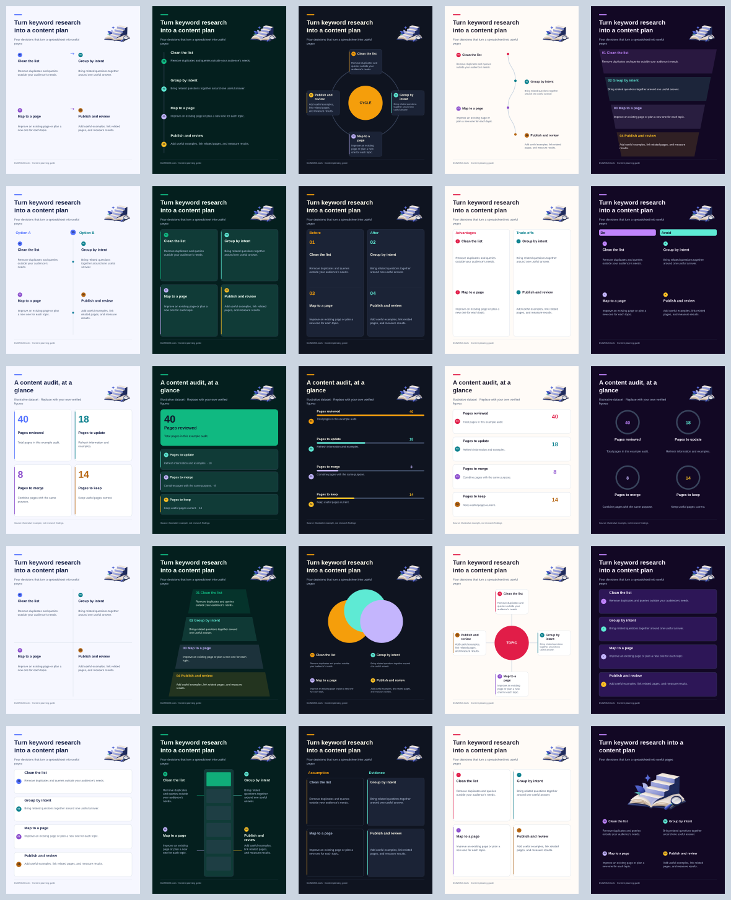

> Current extension contract: [Prism Forge infographic handbook](./PRISM_FORGE_INFOGRAPHIC_HANDBOOK.md), signed `PF::INFOGRAPHIC-DESIGN-V2::2026-11-11`. Its fixed geometry, six editorial layouts and shared export rules supersede the earlier arbitrary-ratio behavior described in this historical baseline.

# Blog section infographic studio

**Current implementation:** see [Prism Forge pilot and manual tests](./PRISM_FORGE_INFOGRAPHIC_PILOT.md). The notes below describe the earlier 25-layout baseline; source selection, the default collection and hero have since been revised.

Redesign based on `main` at `7c86244`, November 11, 2026. Routes: `/tools/blog-section-infographic-generator` and the shared section editor in `/tools/ai-content-writer` (also used by the blog/article writer).

## The design decision

The testimonial handbook provides useful engineering practices: bounded text, measured gutters, stable state, live previews and consistent exports. Its portrait presets, fake proof badges and testimonial compositions do not belong in this tool. The infographic editor deliberately has no portrait imports, founder photos or photo-framing controls.

The supplied Venngage screenshots/video show visual storytelling through timelines, comparisons, hierarchy, meaningful figures and clear reading paths. Research references:

- https://venngage.com/ai-tools/infographic-generator — purpose-specific infographic categories and editable designs.
- https://www.canva.com/create/infographics/ — reusable visual assets, editable layouts and brand controls.
- https://piktochart.com/ai-infographic-generator/ — content-to-outline-to-editable-visual workflow.

These are product references, not copied artwork or a claim of feature parity.

## Reusable artwork plus editable information

A single flattened AI image makes every text correction a regeneration and can introduce incorrect words or data. This implementation separates decorative art from information. Text, values, nodes, source credits, palette and logo stay editable; optional raster artwork gives the output editorial texture. Charts only use user-provided numbers; percentage rings are drawn only for explicit values between 0% and 100%. No fake scores, measured speed or ranking claims are injected.

The original `paper-steps` illustration was generated with the built-in image-generation tool for this project. It is embedded as a compressed 600-pixel PNG in `lib/blog-infographic-studio/editorial-art.json` (palette-compressed for portability) so exported SVG files work offline. No competitor assets are bundled. It is decorative, not evidence or quantitative data.

Generation brief: “A compact isometric paper sculpture of an open book transforming into four ascending architectural paper steps, with a small magnifying glass and abstract star; tactile editorial paper illustration; indigo #5271FF, navy #172554, ivory and a small teal accent; transparent background; no people, labels, numbers, logos or charts.” Format conversion only was applied afterward.

Future assets can follow this same model: generate/review reusable text-free artwork, optimize and embed it once, then add it to the illustration selector. A live image-generation API, Canva integration and API billing are not included. They would require a separate provider, quota, privacy and error-handling design.

## Rendering and persistence contract

The public template catalog lives in `lib/blog-infographic-studio/templates.ts`. Runtime consumers import this focused metadata module; the internal founder-hub roadmap files remain unchanged.

- `buildInfographicScene(config)` is the authoritative pure SVG compiler. Hero, template cards and live preview display this scene. `generateBlogInfographicSvg()` exports it directly.
- `renderBlogInfographicToCanvas()` is now **asynchronous** and rasterizes the same self-contained SVG. Await it before `toBlob()` or `toDataURL()`. A per-canvas request token prevents older renders overwriting new edits.
- Supported sizes remain 1600×900, 1080×1080, 1080×1350 and 1080×1920. Existing IDs 1–25, slugs, imports and modal props remain compatible.
- Layouts allocate headline, subtitle, diagram and source zones separately. Text wraps, reduces within defined font bounds, and is clipped to its allocated box. If it cannot fit, the editor reports the affected field and suggests a taller format. Full information remains in the SVG description and editable project; shortened visible text is marked with an ellipsis. Do not claim arbitrary-length text always fits.
- Dense layouts may use a responsive card arrangement to preserve reading order. Eight long points in a landscape graphic should be shortened or split across sections.
- `BlogInfographicConfig.brand` persists logo data, logo scale/container, custom palette and illustration choice through the writer, IndexedDB project state and ZIP backup. Older configs without `brand` remain valid.
- `patchInfographic()` and template changes invalidate derived PNG/SVG caches. Writer/ZIP compilation regenerates from canonical config rather than trusting stale caches.
- Exported article/WordPress image dimensions match each selected ratio. Image paths use `section-N-infographic.svg`, matching the ZIP contract.
- Uploaded logos are restricted to PNG/JPG/WebP under 2 MB and normalized to a maximum 640-pixel edge. SVG uploads are intentionally excluded because untrusted active/external SVG content should not be embedded.

## Editing experience

Content / Design / Brand tabs separate writing from visual choices. The studio has larger actual layout previews, search and family filters, multi-section tabs, per-point reorder/delete, explicit source credit and alt text, undo/redo, project JSON import/export and batch PNG/SVG ZIP. Importing sections appends rather than deleting existing work. URL extraction and paragraph splitting are starting points for human review, not independent fact verification.

Hero examples contain actual shared renderer output. Rotation pauses on hover, focus and hidden tabs, respects reduced motion and has manual controls. Selecting a hero layout updates the studio without replacing edited content. Examples involving numeric data are explicitly labelled illustrative.

## Validation

`node --import tsx --test tests/ai-tools/blog-infographic-studio.test.ts` covers all 25 templates × four sizes, long text / eight points, escaped SVG, safe project import, brand round trips, cache invalidation, chart values, async raster races and writer dimensions/asset paths.

Also run TypeScript, the AI-tool tests, foundation checks and the production build. Inspect rendered SVG raster sheets for layout fit. Browser interaction, clipboard, PDF downloads and mobile pointer behavior still require manual QA when the managed preview/browser is unavailable. Do not report those as tested merely because image rendering passes.

## Review evidence (November 11, 2026)

The sheet shows actual renderer output with illustrative example content, not screenshots of a tested browser session. All 100 template/format combinations were rasterized with Sharp for visual inspection. Default portrait examples report no text-fit issues.

Nine dedicated regression tests pass, including the embedded editor and hero server-rendered markup. TypeScript passes. The portable build compiled all 125 tools; a focused rebuild of the infographic tool and three writer routes also compiled successfully. The production Next.js build compiles and reaches page-data collection, then stops because this workspace lacks the Sanity `projectId` required by the existing `/api/comments` route.

The wider AI-tool suite has 12 failures and foundation checks have one failure; the same failures reproduce on an untouched checkout of base `7c86244`. These unrelated failures are not hidden by changing test expectations. Managed browser preview was unavailable, so responsive pointer interaction, clipboard permissions and PDF downloads remain browser QA items.
