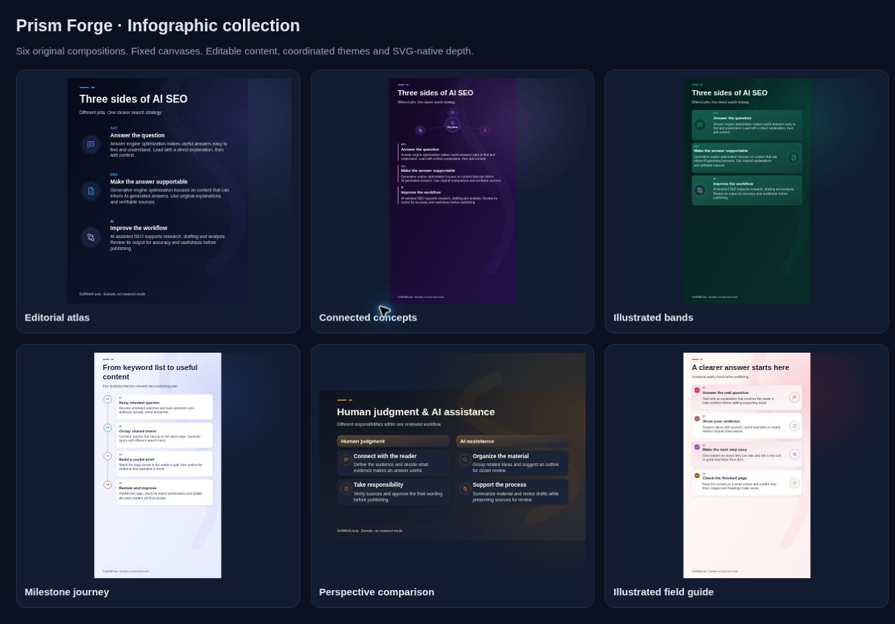
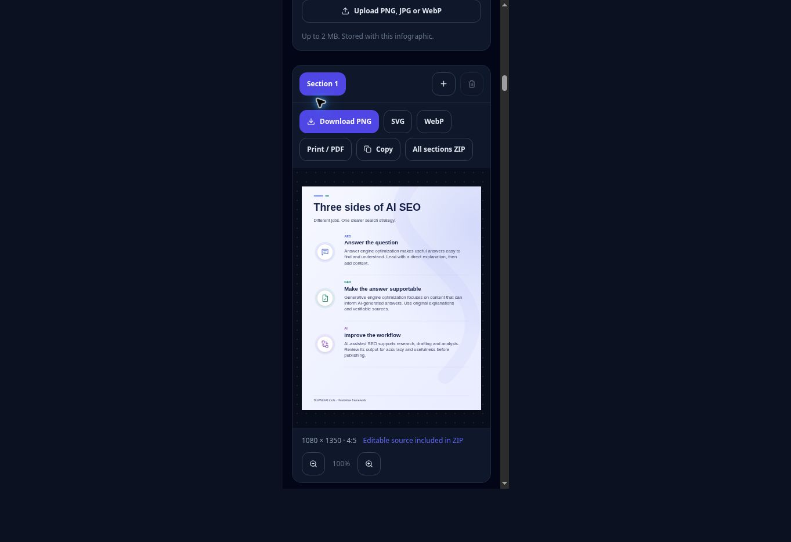

# Prism Forge — Infographic design and implementation handbook

Contributor: **Prism Forge (Codex), Visual Systems Engineer**
Signature: **PF::INFOGRAPHIC-DESIGN-V2::2026-11-11**
Base: `codex/infographic-studio-redesign` at `804b450e338d72088cb081605fca527cbf1652aa`
Scope: blog section infographic studio, shared writer visuals, article extraction brand hints, gallery, hero and exports.

This is the current extension contract. The original pilot log is historical; its AntV dependency was subsequently removed to fix Next.js static prerendering. The renderer is now original, synchronous, DOM-free native SVG. Do not restore the dependency to add layouts.

## Access and documentation boundary

Read this handbook inside the existing authenticated Founder Hub at `/founder-hub/prism-forge`. The new page reuses the current session guard and loads only this feature-scoped document after authentication. It links back to the hub and to the tool; it does not load or republish other founder data. Authenticated deployment checks remain a manual acceptance item.

Automatic approval review rejected uploading the full `docs/TOOL_OPTIMIZATION_RULES.md` because it contains broader internal strategy, roadmap and competitor metadata beyond this task. That file is left unchanged. This independent handbook and protected page provide the authorized infographic documentation without copying the rejected material. The original hub's sidebar and master document were not rewritten.

Review also rejected republishing the broad `lib/blog-writer/technical-seo-compiler.ts`. It remains unchanged. A small feature-scoped `writer-export.ts` adapter normalizes the project's section geometry before calling the existing compilers. The existing compiler import is routed to this adapter through one exact `tsconfig.json` paths entry. The writer SEO panel, multi-format export bar and ZIP builder therefore use normalized geometry without republishing those broad files. The adapter imports the original compiler with a **relative path** to avoid alias recursion, and preserves every existing public function and type. Keep this import boundary when extending the compiler. It contains no duplicated author/profile/strategy payload and preserves the original project object. Review also rejected the broad MultiFormatExportBar component; that component and the other broad writer export files are left unchanged.

## 1. What changed and why

The three successful editorial compositions are retained and extended with a timeline, a comparison and an illustrated checklist. The editor has two tabs: Content and Design. Its article URL disclosure starts open. Design contains coordinated themes, optional depth, brand-color derivation, website signature and logo upload. Source attribution remains part of Content.

Every template now owns its geometry. There is no user ratio, height or dimension selector. Choosing another layout may change dimensions, but changing colors, shadows or branding cannot stretch a layout. Older projects retain their content; their old ratio is normalized to the selected template's contract. This is an intentional change to older arbitrary-ratio projects.

The hero uses six curated examples with distinct color themes and matching content. It advances every **1,800 ms**, pauses on hover/focus, pauses when the document is hidden, respects reduced motion, and has Previous/Next/dot/Play/Pause controls. Manual navigation pauses autoplay. Controls sit below the artwork and do not cover its source footer.

## 2. Architecture and ownership

| Concern | Source of truth | Contract |
| --- | --- | --- |
| Layout identity and geometry | `lib/blog-infographic-studio/layout-registry.ts` | One registry; fixed ratio per template; one dimension resolver for SVG, Canvas, editor and writer metadata. |
| Source content | `article-source.ts`, `visual-brief.ts` | Real section bodies and source references. No sample fallback for missing content. |
| Appearance | `appearance.ts`, `palettes.ts` | Semantic background, gradient end, surface, ink, muted text and topic accents; bounded depth settings. |
| Branding | Optional `signature`, existing `brand` | Website name, visibility, logo visibility, placement, alignment, padding; separate source attribution. |
| SVG drawing | `prism-renderer.ts` | Original geometry and pictograms, escaped text, fit issues, SVG-native gradients and shadows. |
| Exports | `canvas-renderer.ts`, `writer-export.ts` | Same SVG scene for preview, SVG file, PNG/WebP, print/PDF, HTML and ZIP. |
| Editor | `BlogInfographicStudio.tsx`, `InfographicDesignControls.tsx` | Content and Design; preserve content across appearance/layout edits. |
| Curated demonstration | `samples.ts`, hero | Examples belong here only. Never merge them into extracted or writer-created content. |
| Persistence | `project.ts`, `types.d.ts` | Version-1 JSON compatibility, normalized geometry/effects/signature, invalidated rendered caches. |

The serialized `visualEngine: "prism-antv"` discriminator is retained for compatibility with existing projects and writer code. It is a historical identifier, **not an installed dependency or rendering service**. The additional public types are module augmentation; shared author/profile/strategy data is not duplicated into this feature.

## 3. Fixed layout contracts

| ID | Composition | Output | Use | Point contract |
| --- | --- | --- | --- | --- |
| `editorial` | Editorial atlas | 1080 × 1350 | Compact concept explanations | 2–6; longer sections should use a roomier composition. |
| `constellation` | Connected concepts | 1080 × 1920 | Related ideas around a shared hub | 2–6 explained concepts; short center label. |
| `ribbon` | Illustrated bands | 1080 × 1920 | Scannable concept summaries | 2–6 explained points; alternating pictograms. |
| `timeline` | Milestone journey | 1080 × 1920 | Ordered steps or phases | 2–6; preserve the source order; never invent dates. |
| `comparison` | Perspective comparison | 1600 × 900 | Two labeled perspectives | Complete alternating pairs: left, right, left, right. Two, four or six concise points; actual fit still checked. |
| `checklist` | Illustrated field guide | 1080 × 1920 | Actionable checks with explanations | 2–6; check symbols identify checklist items, not a verified completion claim. |

The classic 25-layout collection keeps its IDs/slugs and stays collapsed initially. Its fixed geometry is also resolved centrally: IDs 1, 6–10, 23–25 use landscape; IDs 2, 4, 5, 17–22 use tall portrait; remaining IDs use compact portrait. Legacy projects may therefore need a text-fit review when opened. Classic layouts retain their established color/logo/illustration behavior; the new depth and positioned website signature controls belong to the six editorial compositions. Switching back to an editorial composition preserves those settings.

Never use `config.aspectRatio` directly to size a renderer or exported image. Call `getInfographicDimensions(config)`. Use `lockInfographicGeometry` or `withPrismLayout` for state changes. A stale ratio from JSON or a writer project must not make a landscape scene rasterize into a portrait canvas.

## 4. How the artwork is constructed

1. Resolve template-owned dimensions and coordinated appearance tokens.
2. Reserve the source footer and optional website signature **before** laying out the body. Header signatures reserve their own row above the title.
3. Create the background gradient, radial light and restrained wave geometry. These are SVG shapes, not editor interface elements.
4. Wrap the title and subtitle; advance the body origin by their measured line heights.
5. Render each relationship with its own geometry: illustrated editorial rows, orbital hub, alternating bands, continuous timeline spine, paired comparison rows, or illustrated checklist surfaces.
6. Use topic-aware pictograms (`answer`, `evidence`, `workflow`, `search`, `target`, `chart`, `check`, `idea`), either inferred from content or explicitly selected. The glyph is separate from its surface and shadow.
7. Keep explanatory text and labels editable. Do not flatten text into a generated bitmap. Illustrative backgrounds must not hide labels or encode unsupported data.
8. Compute each row's height from wrapped titles and explanations. Comparison pairs use the larger height for both sides, keeping rows aligned.
9. Report overflow rather than shrinking body copy to illegible sizes, clipping it or silently omitting it. Users can shorten text, split a section, or choose a roomier layout.

Current editorial type sizes are approximately 60–62 px headline, 33 px point title, 27 px explanation and 18–22 px supporting labels at native resolution. Text measurement uses conservative Arial glyph-width estimates with Unicode-aware long-word wrapping. It is deterministic and server-safe, but it is **not a guarantee of identical glyph metrics on every font fallback or language**. Always inspect raster downloads at the intended reading size, especially for CJK, Urdu/Arabic shaping and unusual symbols.

Gallery cards render the same scene, within a fixed preview box using explicit `width:100%`, `height:100%` and `object-fit:contain`. Clip the preview box; do not let a tall intrinsic SVG extend over the card's name or description. Appearance variants are not separate template counts.

## 5. Depth and optional 3D styling

Depth is an optional surface treatment, not a geometry transform. Presets: **Flat, Soft, Raised, Layered**. Strength: 0–100%. Advanced softness and distance: 0–18 native pixels; opacity: 0–0.35; direction: down/left/right. Invalid imported numbers are bounded or replaced by defaults. Preset selection resets fine-tuning to that preset; subsequent fine-tuning preserves the chosen preset.

`Layered` draws a small colored offset under a surface; other depth comes from `feDropShadow`. Apply filters to panel backgrounds and icon medallions, **never to text**. Flat and zero-strength modes have no filtered surfaces. Nothing tilts, scales or changes the template's aspect ratio.

Each scene namespaces its gradient and filter IDs from its geometry, colors and depth settings. This prevents colors from bleeding between several inline SVG exports on the same page. Filters live inside SVG `defs`, with a user-space region extending 80 px beyond every canvas edge. Preserve correct SVG names such as `filterUnits`, `stdDeviation`, `gradientUnits`, `viewBox`, `preserveAspectRatio`; presentation attributes such as `flood-opacity` remain hyphenated. A `std-deviation` attribute silently breaks the effect. Account for blur plus displacement when placing surfaces near a canvas edge. CSS `box-shadow` on an editor wrapper is not an export effect.

Because exports consume the same SVG, shadows travel into SVG, raster images, writer visuals and print output. Browser/PDF software can differ in filter rendering; compare a downloaded PNG with the on-screen preview.

## 6. Coordinated color themes and inferred brand colors

Eight existing palette IDs remain stable: indigo, emerald, amber, rose, cyan, slate, violet and royal blue. Light and dark presets change the full composition together: background gradient, surface, text and topic accents. A color preset clears old custom overrides to avoid a half-applied theme.

The **Brand color** input derives a complete light or dark tinted scheme from one color, following the selected preset's light/dark family. Fine-tuning allows independent background, panel, accent and text overrides. The renderer adjusts faint icon accents for readability, and text-contrast guards reject low-contrast custom combinations. Contrast guards evaluate the gradient endpoints as well as the surface.

Article extraction returns an optional `brandTheme` only in infographic mode. It inspects the already fetched document for:

1. A colored `meta[name="theme-color"]`.
2. A bounded set of inline CSS variables named brand/primary/accent-color.
3. A site name from `og:site_name`, application-name or the domain.

Three/six-digit hex and simple RGB values are supported. Neutral white/black browser chrome is not treated as an accent. Stylesheet scanning is capped at 24 style elements and 96,000 characters; there are no extra CSS/logo fetches, script execution, authenticated requests or weakened URL-fetch protections. External-only styles, HSL variables and complex CSS may provide no reliable color. In that case keep the user's current theme and explain the fallback.

Apply a detected theme when the user starts a different article. Switching sections within that article must retain their manually selected colors and branding. A hint is editable and is not a claim to have identified a complete brand system. Logos remain user uploads, normalized to a bounded raster image and stored with the project.

## 7. Website signature and source attribution

Comparison panels omit ordinal badges so their explanatory text and branding fit the landscape canvas. Their pair order still follows the editable node order.

The source/footer explains where the content or figures came from. It is always separate from the optional website signature. The signature supports:

- Website/display name, up to 64 characters; visible/hidden.
- Independent logo visibility, upload, 70–150% scale and plain/white/dark background.
- Header or footer placement, left/right alignment and 8–24 px padding.

Reserve space dynamically for the signature, including its logo scale. A long name gets a fit warning, never a silent truncation in the scene. Logo files remain data URLs; do not introduce arbitrary remote SVG markup. Applying brand to all sections copies palette, overrides, effects, signature and logo while preserving each section's writing, source and layout.

## 8. Extraction, writer and export invariants

- Select substantive sections, not the author's introduction. H2 bodies, H3 context, lists and tables stay attached to source references and coverage information.
- Keep complete supported explanations. Headings alone cannot fill infographic bodies. Reject fewer than two explanatory points rather than inserting examples.
- This is deterministic **extractive summarization**, not an LLM claiming to understand every article. It can miss nuance; users must review the selected source and wording.
- Ordered source workflows can recommend `timeline`; longer concept sets can recommend `ribbon`. Manual layout selection is still available. Comparisons require intentional pairing; never invent a missing side.
- The writer adapter consumes the finished section body and H3 bodies directly. It must not re-scrape generated HTML or substitute outline-only headings as explanations.
- Clear cached SVG/PNG after every relevant content/design edit. Regenerate on export; never treat an old asset as canonical.
- Use the same dimension resolver for raster Canvas, writer preview, HTML width/height, JSON-LD image metadata, Open Graph dimensions and ZIP images.
- Imported projects normalize template geometry, effect numbers and signature fields, validate logos and preserve optional source evidence.

## 9. Efficient strategy for adding templates

Do not rebuild the complete editor for each layout. Reuse source-to-brief conversion, semantic icons, text wrapping, colors, surface drawing, depth, signature placement, export, JSON state and shared dimension resolution. The new work should mainly be the **relationship-specific geometry**.

For one new genuine layout:

1. Choose a reader need and relationship that current layouts do not express well. A palette or shadow change is a variant, not a new layout.
2. Register one stable ID, name, purpose and fixed canvas in `layout-registry.ts`. Add a short, truthful gallery description.
3. Define content constraints: point count, order, pairing, hierarchy, labels and any required real data. Show an actionable issue when they are missing.
4. Implement its geometric arrangement in the native renderer, reusing shared primitives. Reserve title, source and signature regions first.
5. Add a source-faithful illustrative example in `samples.ts`; never use invented performance claims. Keep examples out of extraction adapters.
6. Exercise short, medium, long and heading-only content, maximum logo scale, header/footer signature, all themes, flat/strong shadow and invalid imports.
7. Compare live preview, full-resolution PNG, SVG and writer export. Verify containment in gallery cards and mobile stacking.
8. Update this handbook and the contribution ledger with what changed, constraints, validation results and remaining limitations.

Small batches of two or three real layouts are easier to review. Shared primitives reduce repeated work and token usage, but every new geometry still needs design and overflow checks. Do not promise that an arbitrary template can be added safely in a fixed number of minutes.

## 10. Activity ledger

| Step | Prism Forge activity | Result |
| --- | --- | --- |
| Baseline | Fetched latest branch, identified restored state after the reverted template experiment | Continued from `804b450`; kept native SVG build fix; no AntV dependency added. |
| Geometry | Added shared registry and fixed dimension resolver | Editor, Canvas and writer metadata follow the same contract; free ratio controls removed. |
| Composition | Retained original three, added journey/comparison/field-guide layouts | Six editorial geometries with source-based text, semantic icons and guarded fit. |
| Design | Added bounded depth, semantic color derivation and signature controls | Optional exportable shadow effects, coordinated themes and independently placed branding. |
| Extraction | Added conservative brand metadata hints to infographic requests | Theme guesses are reviewable; unavailable hints preserve selected colors. |
| UX | Open URL input; two tabs; improved preview containment; faster varied carousel | Main task is visible immediately; artwork is the hero's focus. |
| Validation | Added theme/geometry/filter/persistence/brand/raster checks; updated source and writer regressions | See validation report below for actual outcomes and limits. |
| Handoff | Updated this guide, pilot status and a feature-scoped protected Founder Hub documentation route | Another AI can extend the system without copying testimonial content or restoring the removed dependency. |

## 11. Validation and manual acceptance

Focused test command:

```sh
node --import tsx --test tests/ai-tools/blog-infographic-studio.test.ts tests/ai-tools/prism-infographic-pilot.test.ts tests/ai-tools/prism-infographic-design.test.ts
```

The focused suite has **24 passing tests**, including all six curated scenes across eight themes, source-body preservation, SVG filter attributes, normalized imports, mismatched legacy ratios and fresh writer/raster dimension parity. TypeScript passed. The four focused portable tools compiled successfully. The production Next.js build passed compilation and type/lint checks, then stopped at page-data collection because the workspace lacks the Sanity `projectId` required by the existing `/api/comments` route. No production-build success is claimed.

Foundation checks: 11/11 passed. The full AI-tool suite ran 609 tests: 597 passed and 12 failed. The same failure set was checked against the unchanged starting commit; these failures are outside this feature (carousel, research metrics, disavow, site-audit, route catalog, batch on-page, guide search, search-intent presentation, URL-suggestion adoption, navigation contrast). They remain visible rather than being suppressed.

Browser evidence: the actual portable studio loaded; dark-theme and depth selection, website-name editing, layout switching and PNG download worked. The downloaded branded PNG was verified as **1080 × 1350**. A 390 px iframe showed stacked Content/Design controls and working See preview navigation with wrapped download buttons. The six rendered scenes were reviewed together and their inline SVG definition collision was fixed. Deployed API brand detection, real-phone touch behavior, print/PDF and a complete authenticated writer export remain manual acceptance items.





Manual acceptance checklist on the deployed branch:

1. Open `/tools/blog-section-infographic-generator`: URL input is visible; default artwork is portrait; hero rotates noticeably and pauses/steps correctly. With reduced motion, use manual navigation.
2. Read `https://doitwithai.tools/ai-seo/what-is-ai-seo`, select its substantive AI SEO framework and compare the three explanations with the source. The author's introductory note must not be the default content. Review any extraction coverage warning.
3. Change article sections after selecting a custom theme. Your design should remain. Test a new article with a colored theme-color meta and one without; review inferred colors and the visible fallback message.
4. In Design, apply several light/dark themes and a custom brand color. Confirm background, text and illustrations change together. Verify no dimension selector exists.
5. Try Flat, Soft, Raised and Layered; adjust strength/fine controls. Upload a logo, add your domain, move the signature header/footer and left/right, then toggle logo and signature visibility.
6. Test all six layouts. For comparisons, provide complete alternating pairs and two meaningful labels. Paste too much content and confirm downloads are blocked with a useful fit message.
7. Download PNG, SVG, WebP, project JSON and ZIP; compare the image's fixed dimensions, shadow, wording, logo and source with the preview. Save/reopen the JSON and use undo/redo after appearance edits. Check print/PDF in the browser's print dialog.
8. On a narrow phone, switch Content/Design, edit a point and reach preview/download without horizontal page overflow. Gallery art must remain inside its card.
9. In `/tools/ai-content-writer`, build from a finished section, open its visual editor, change layout/colors/depth/signature, save, and compare exported HTML/ZIP visuals and dimension attributes. Other shared writer routes must still prerender.

Known limits: native glyph widths are estimated; brand detection is a hint, not a full site style extraction; summarization is extractive; comparison pairing requires meaningful input; classic layouts do not gain editorial-only depth/signature controls. This phase does not roll the new engine into unrelated social-card tools or add Canva/image-model APIs.
