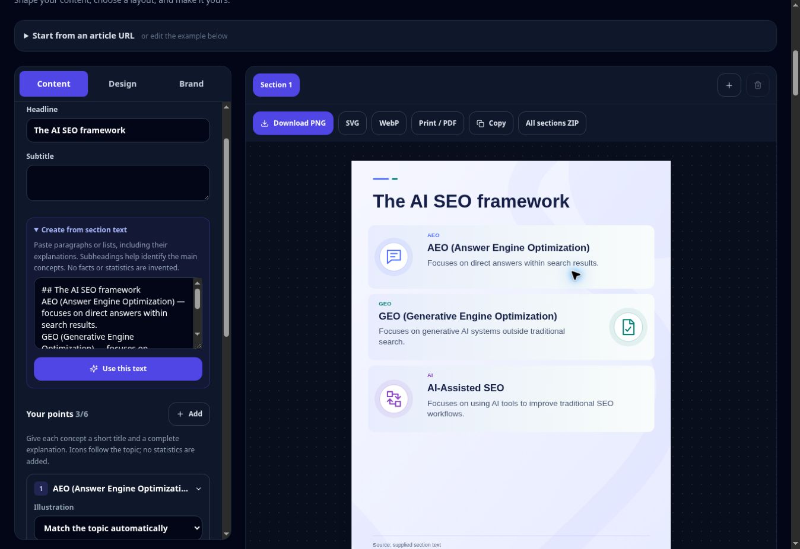

> Historical pilot record. Current implementation and replication rules: [Prism Forge handbook](./PRISM_FORGE_INFOGRAPHIC_HANDBOOK.md). The subsequent native-SVG build fix removed the AntV dependency described below. The current collection contains six fixed-size editorial compositions with coordinated themes, depth and positioned website signatures.

# Prism Forge: infographic pilot

AI contributor: **Codex**, working name **Prism Forge** — Visual Systems Engineer.
Signature: `PF::INFOGRAPHIC-PILOT::2026-11-11`.
Scope: `/tools/blog-section-infographic-generator` and its shared AI content/blog/article writer visual flow. This is a first integrated pilot: three new editorial compositions, with the existing 25-layout collection retained separately.

## What changed

The source reader no longer treats an article's first heading or a founder introduction as the default infographic. An infographic-specific extraction mode selects the main article, retains H2 sections with nested H3 context, paragraphs, lists and tables, assigns stable source-block IDs, and recommends a substantive section. Introductory and promotional sections remain distinguishable. The response reports section/block coverage and explicit extraction limits (36 sections, 1,200 blocks, 90,000 characters).

Each visual has a source brief. It prefers an author's explicit list of explained concepts; otherwise it selects explanatory sentences under the section's subheadings. This is deterministic extractive selection, not an LLM paraphraser or independent fact checker. No metric, percentage or citation claim is synthesized from a date or heading. Missing explanations produce a useful message instead of empty cards. The source panel retains the original selected section and reports excluded/omitted material for human review.

The live article `https://doitwithai.tools/ai-seo/what-is-ai-seo` was fetched for investigation. Its substantive framework section is recommended instead of “A Note Before We Begin.” The explicit AEO, GEO and AI-assisted SEO list supplies three explained points. The accompanying small test fixture preserves that representative source structure.

## Rendering decision

`@antv/infographic` is pinned to **0.2.20** (MIT). The pilot uses its public **DOM-free JSX/SVG compiler** and text metrics to compose original editorial masters. It does not mount AntV's full browser editor or its SSR DOM shim. This preserves the application's synchronous SVG API, avoids process-global DOM mutation, and keeps the same scene available to previews, Canvas rasterization, writer HTML and ZIP exports.

The three compositions are Editorial atlas, Connected concepts, and Illustrated bands. They have distinct geometry, a consistent type scale, topic-aware vector pictograms, restrained gradient/wave backgrounds, reserved source/logo space and portrait-first sizing. Icons can be changed in the editor. These are original compositions, not imported Canva templates. No AI image generation, Canva API or per-image model call is required.

Content, source IDs, composition, brand, logo, colors and icon choices remain editable canonical data. Optional feature fields are declared in the public `lib/blog-infographic-studio/types.d.ts` extension; the shared model file and its internal project data are unchanged. The PNG is a flattened export; the editable project remains JSON and the SVG retains vector text and paths. Preview and export use one scene. Invalid text fit, missing explanations and insufficient contrast block new-layout exports with actionable messages. The renderer does not silently shrink text below the readable pilot scale or export cropped content.

The 25 legacy IDs and slugs remain compatible. Their gallery is collapsed initially to reduce rendering work. Existing saved projects stay supported. Choosing a classic layout explicitly switches back to the legacy renderer; choosing an editorial layout preserves writing and branding.

## Editor and hero

The content, design and brand panels remain. On narrow screens the editor stacks without a second fixed-height scrolling panel. Only the first point opens initially; a See preview shortcut avoids a long scroll through controls. Source coverage, point titles, full explanations and semantic icon controls are available in Content. Undo/redo, reorder, section tabs, logo upload, project import/export, PNG, SVG, WebP, PDF/print and ZIP retain the existing workflow.

Article selection replaces the current visual rather than making a new visual for every paragraph. Use Add section before choosing a second source section to keep both; Undo restores a previous selection. A source that needs extra height starts in tall portrait. Long edits still need a fit check.

The hero shows actual portrait renderer output with compact controls over the graphic. Rotation is 2.4 seconds with a short fade. Hover, focus, hidden tabs and reduced-motion preferences pause automatic rotation. There are no testimonial portraits or technical banners around the simulation.

## Writer integration

The full-draft API feeds the completed section body and H3 bodies directly into the same source-brief adapter. An outline alone is not factual source material. “Regenerate visual nodes” rebuilds from the current section instead of trusting arbitrary model-generated KPI labels. The shared editor also has “Build from this section's content.” Saving keeps the section ID, brand and new composition with fresh SVG/PNG caches.

Existing writer quick-cycle controls recognize the three new compositions. The inline writer preview displays a content/fit error instead of silently leaving a blank or stale canvas. HTML and ZIP exports regenerate the selected scene; old cached SVG is not treated as authoritative.

## Manual acceptance checklist

1. Open `/tools/blog-section-infographic-generator`. Confirm a portrait graphic appears first; wait roughly 2.4 seconds and check rotation. Hover/focus should pause. With reduced motion enabled, use the manual buttons.
2. Expand “Start from an article URL,” paste `https://doitwithai.tools/ai-seo/what-is-ai-seo`, and read the sections. The framework should be selected, with AEO, GEO and AI-assisted SEO explanations. The founder's biography should not appear in the visual.
3. Open Source & coverage. Compare the cited list items to the original article. Select another substantive section and check its content changes. Use Undo, or Add section before choosing another topic to keep both visuals.
4. Edit a title and explanation; choose a topic icon, upload a logo, change the palette, and switch between all three editorial compositions. Check that wording and branding survive. Open the classic collection and confirm its original layouts are still usable.
5. Paste a section containing H3 headings and body paragraphs. Check that headings become titles and useful body sentences become explanations. A headings-only paste must ask for explanatory content.
6. Enter an overlong explanation. Check the text-fit warning and blocked export. Try tall portrait, shorten the wording or split the visual. Try low-contrast custom colors and verify the warning. Avoid forcing every section into one layout.
7. Download PNG, SVG and WebP, then compare text, icons, logo and colors with the preview. Check PDF/print and clipboard on your browser. Download the ZIP, re-import the JSON and confirm the same composition, source brief and branding return.
8. In `/tools/ai-content-writer`, generate a full draft. Check that section visuals use the completed text, then open Customize infographic. Use “Build from this section's content,” edit and save. Reopen it, cycle compositions, and export the article ZIP. Compare its SVG/PNG assets with the saved preview.
9. Test on a phone-sized screen: no page-level horizontal scrolling, readable form labels, accessible point controls, and preview/gallery below the stacked editor. Recheck with a long headline and six points.
10. Read this signed implementation document for the contributor identity and test record. The protected founder-hub source is unchanged; its existing sign-in behavior is preserved.

## Validation record

- Dependency install: repository-pinned pnpm 10.34.5 completed with a frozen lockfile. Existing dependency resolutions were preserved; the AntV dependency graph was added.
- Dedicated regression suite: 16 tests passed, covering extraction, source evidence, three compositions, export fit guards, project persistence, writer parity and all classic layouts.
- TypeScript: passed. Targeted ESLint: zero errors; three native-image warnings (two existing promotional images and the SVG showcase).
- Wider AI-tool suite: 601 tests, 589 passed, with the same 12 previously recorded baseline failures. No unrelated expectations were changed to hide them.
- Portable builds: infographic, content writer, blog writer and article writer all compiled successfully.
- Production Next.js build: compiles successfully and passes type checking; page-data collection is blocked by missing Sanity project configuration in the existing `/api/comments` route. This workspace also lacks the optional Redis credentials. Production deployment was not performed.
- Browser checks: actual component build loaded in the managed static preview. Pasted section text produced three explained, cited concepts; changing compositions retained content; a headings-only paste showed the expected actionable error. PNG and project downloads completed. The downloaded PNG was verified as 1080 × 1350. A 390-pixel iframe was visually checked for the stacked editor; phone interaction remains a manual acceptance item.
- The static preview wrapper uses an external JS bundle because its live-reload server injects code into inline HTML strings. Production application code was not changed to work around that preview behavior.
- Live article HTML was fetched and passed through the new source parser. A direct call to the URL API in this workspace could not complete because its existing SSRF-safe fetcher encountered an environment DNS resolution failure (`EAI_AGAIN`). Verify live URL extraction on the Vercel preview using checklist step 2.
- Clipboard permissions, PDF printing, the writer's complete cloud drafting flow remain manual checks; they are not represented as verified browser actions.

Actual renderer output:

Actual browser editor after pasting the section's explanations:

## Publishing boundary

Automatic approval review rejected uploading the founder-hub page because it contains protected internal command-center metadata and authentication structure. That page was restored unchanged. Review also blocked uploading the shared model file because it carries internal project metadata. Its source was restored; only the new optional infographic field declarations are supplied in a public type extension. This scoped document contains the requested Prism Forge identity, implementation details and manual checklist without copying the protected command center.

## Deliberate pilot limits

This pilot establishes three polished concept/summary compositions; it does not claim to cover hundreds of infographic styles. Legacy specialist diagrams remain available. The next useful additions are genuine process, comparison and source-validated data compositions, after reviewing this pilot's output.

Extractive selection can preserve an incomplete or inaccurate statement from the article. Review the draft. Tables stay available as source text; this pilot does not infer chart values or units. Protected or heavily client-rendered pages may require pasted text. Freeform canvas dragging, arbitrary chart builders and automatic conversion of flattened AI imagery into editable vector objects are outside this first pass.

Do not remove safeguards or insert placeholder statistics to make a dense section fit. Expand the design library only after source selection, layout fit, editing persistence and preview/export parity pass with representative real articles.
